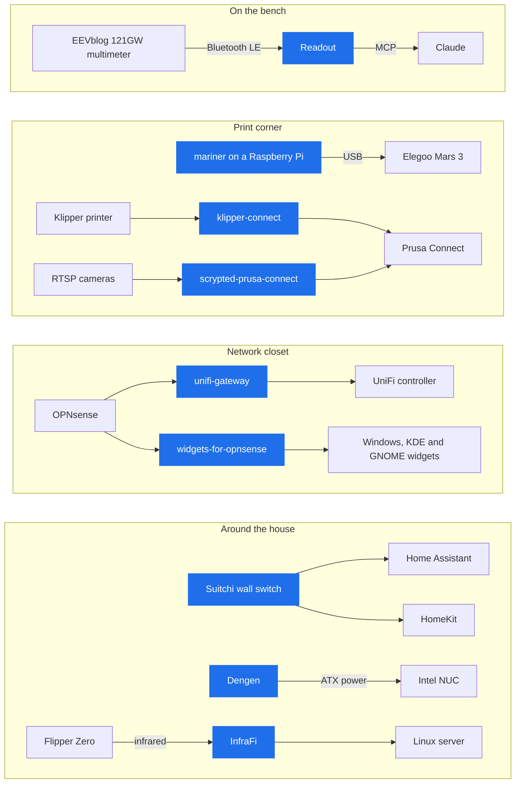

# Hey, I'm Alejandro 👋

### About me

Most of what I build is software for hardware I own: my multimeter, my 3D printers, my firewall, the switches on my walls.

- I write a lot of C# and .NET: Windows desktop apps, cross-platform apps with .NET MAUI, and an Outlook add-in or two
- I also solder, flash ESP8266 boards and write firmware in C and C++
- My homelab runs OPNsense, Home Assistant, Klipper and a lot of Docker containers
- Recently I've been adding MCP servers so AI assistants can talk to that hardware

### Where my code runs

The blue boxes are my projects. Everything else is the hardware or service they talk to.

Repos in the map: [Readout](https://github.com/amd989/readout) · [mariner](https://github.com/mariner3d/mariner) · [klipper-connect](https://github.com/amd989/klipper-connect) · [scrypted-prusa-connect](https://github.com/amd989/scrypted-prusa-connect) · [unifi-gateway](https://github.com/amd989/unifi-gateway) · [widgets-for-opnsense](https://github.com/amd989/widgets-for-opnsense) · [Suitchi](https://github.com/amd989/Suitchi) · [Dengen](https://github.com/amd989/Dengen) · [InfraFi](https://github.com/amd989/InfraFi)

### Elsewhere on GitHub

- [mariner3d/mariner](https://github.com/mariner3d/mariner) is a web interface for resin printers with ChiTu boards (Elegoo, Phrozen, Anycubic and others). Most of its commits over the last few months are mine, for mariner 2.
- I'm also a member of [unofficial-unifi](https://github.com/unofficial-unifi), which installs the UniFi controller on pfSense and OPNsense, and of [flipperdevices](https://github.com/flipperdevices).

### Latest from the blog

I write up most of these projects on [The Maker Shed](https://blog.alejandro.md).

<!-- BLOG-POST-LIST:START -->
- [Widgets for OPNsense: My Router on the Windows Widget Board](https://blog.alejandro.md/2026/11/widgets-for-opnsense/)
- [Readout: A Companion App for the EEVblog 121GW](https://blog.alejandro.md/2026/11/readout-a-companion-app-for-the-eevblog-121gw/)
- [Elegoo Mars 3: 04 Remote Control with Mariner 2](https://blog.alejandro.md/2026/05/elegoo-mars-3-04-remote-control-with-mariner-2/)
- [InfraFi: Sending WiFi Credentials Over Infrared with a Flipper Zero](https://blog.alejandro.md/2026/04/infrafi-sending-wifi-credentials-over-infrared-with-a-flipper-zero/)
- [The Story Behind iTunesLyrics](https://blog.alejandro.md/2026/04/the-story-behind-ituneslyrics/)
<!-- BLOG-POST-LIST:END -->

### What I use

  
  
  
  
  
  
  
  
  
  
  
  

